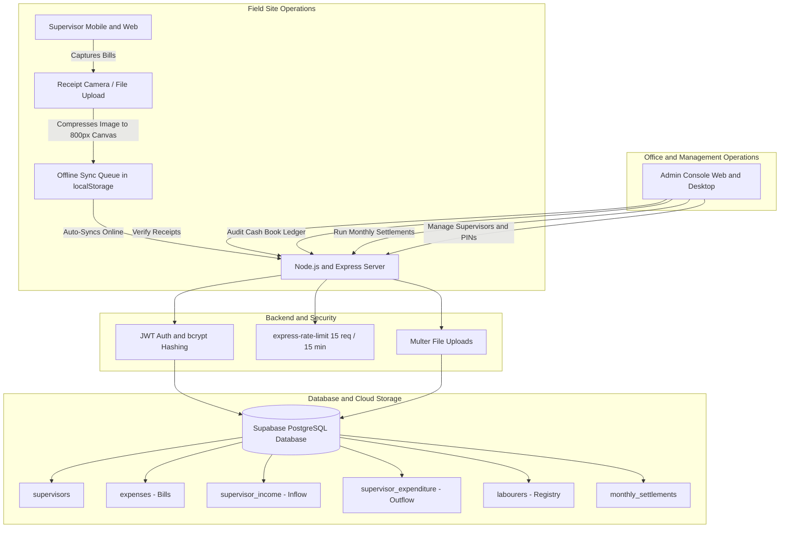

# 🏗️ Site Bill Tracker (Company Logs)

[](https://react.dev/)
[](https://vitejs.dev/)
[](https://nodejs.org/)
[](https://supabase.com/)
[-119EFF?style=flat-square&logo=capacitor&logoColor=white)](https://capacitorjs.com/)
[]()

An end-to-end site expense management, petty cash book, and receipt auditing platform designed for construction projects, field operations, and contractor teams.

**Site Bill Tracker** bridges the communication gap between on-site supervisors handling physical cash, daily labour wages, and vendor receipts, and company administrators who audit expenditures, verify bills, and calculate monthly payroll settlements.

---

## 🌟 Key Highlights

- **Dual-Role Architecture:** Dedicated streamlined workflows for both on-site **Supervisors** and company **Administrators**.
- **Camera-to-Cloud Receipt Logging:** Snap receipt photos directly on mobile; images are compressed client-side via HTML5 Canvas before instant upload to keep bandwidth usage minimal.
- **Complete Site Cash Book:** Track petty cash inflows (advances), outflows (daily labour wages, materials/general site expenses), and supervisor-to-supervisor handovers.
- **Offline-First Resilience:** Field network cut off? Logs queue up in local storage and sync automatically when internet connectivity resumes.
- **Admin Verification & Monthly Settlements:** Review pending expenses, mark them verified, inspect receipts in a full-screen lightbox modal, and generate closed monthly settlement balances.
- **Native Android & iOS Support:** Packaged with Capacitor 8 for zero-friction installation as a native APK or IPA on site supervisors' mobile devices.

---

## 📋 Table of Contents

- [Architecture & Workflow](#-architecture--workflow)
- [Feature Breakdown](#-feature-breakdown)
  - [1. Supervisor Portal](#1-supervisor-portal)
  - [2. Admin Control Console](#2-admin-control-console)
  - [3. Financial Settlement Engine](#3-financial-settlement-engine)
  - [4. Security & Performance](#4-security--performance)
- [Tech Stack](#-tech-stack)
- [Project Directory Structure](#-project-directory-structure)
- [Database Schema (Supabase)](#-database-schema-supabase)
- [Getting Started](#-getting-started)
  - [Prerequisites](#prerequisites)
  - [1. Clone and Install Dependencies](#1-clone-and-install-dependencies)
  - [2. Environment Configuration](#2-environment-configuration)
  - [3. Database Setup](#3-database-setup)
  - [4. Run in Development Mode](#4-run-in-development-mode)
- [📱 Mobile App Development (Capacitor)](#-mobile-app-development-capacitor)
- [REST API Reference](#-rest-api-reference)
- [License](#-license)

---

## 🏗️ Architecture & Workflow



---

## ⚡ Feature Breakdown

### 1. Supervisor Portal
- **Fast PIN Login:** Simple, memorable numeric PIN authentication without requiring email or password credentials on noisy site devices.
- **Bill & Receipt Submission:**
  - Enter total amount, date, optional merchant/category note.
  - Upload receipt photo via mobile camera or photo gallery.
  - **Client-Side Compression:** Images automatically scale to a max 800px width/height and re-encode to high-efficiency JPEG prior to transmission.
- **Petty Cash Management:**
  - **Cash Inflows:** Log cash received from management or company accounts.
  - **Cash Outflows:** Categorize payouts into **Daily Labourers** (selected from official roster), **General Site Purchases** (cement, tools, fuel), or **To Supervisor** (handing off cash to another site supervisor).
- **Monthly Ledger Archives:** Filter logs by month folders to track balance, verify pending statuses, and avoid double claims.
- **Offline Mode:** If on-site 4G drops, receipts and expenses are securely queued in `localStorage` with a visible offline indicator badge, then dispatched sequentially upon reconnection.

### 2. Admin Control Console
- **Centralized Master Ledger:** Filter all entries across all sites by supervisor, month, specific date, payment type, or verification status.
- **Interactive Receipt Inspector:** Inspect full-resolution photos of vendor receipts and tax invoices in a zoomable lightbox overlay.
- **One-Click Verification:** Mark line items as **Verified** or revert them to **Pending** with live status badges.
- **Supervisor Management:**
  - Create new supervisor profiles.
  - Reset or edit supervisor PIN codes securely.
  - Delete retired supervisors.
- **Labourer Master Registry:** Add, view, or manage registered daily wage workers, automatically feeding supervisor payout dropdown menus.

### 3. Financial Settlement Engine
At the close of each calendar month, administrators can reconcile each supervisor's financial account:
- **Total Inflow (Cash Received):** Aggregated sum of all advances.
- **Total Outflow (Cash Expended):** Aggregated sum of all verified site payouts.
- **Cash Left on Hand:** $\text{Inflow} - \text{Outflow}$ currently held in physical cash by the supervisor.
- **Net Salary Payable:** Supervisor Base Salary minus unreturned physical cash balances.
- **Lock & Settle:** Lock finalized records into the `monthly_settlements` table to prevent retrospective tampering, with an authorized unlock ("Unsettle") safeguard.

### 4. Security & Performance
- **bcryptjs Hashing:** All supervisor and admin PINs are salted and hashed before storing in the database.
- **JWT Authentication:** Strict authorization tokens passed via HTTP `Authorization: Bearer <token>` headers with auto-logout on session expiration.
- **Brute-Force Rate Limiting:** Login attempts are bounded via `express-rate-limit` (15 requests per 15 minutes per IP).
- **Optimized Assets:** Canvas-based client compression slashes receipt image payloads from 8MB–12MB down to ~150KB–300KB.

---

## 🛠️ Tech Stack

| Domain | Technology | Details |
|---|---|---|
| **Frontend Framework** | [React 19](https://react.dev/) | React 19 with Vite 8 HMR bundler |
| **Styling** | Vanilla CSS | Custom responsive design system with segmented controls, glassmorphism modals, and dark/light accents |
| **Mobile Runtime** | [Capacitor 8](https://capacitorjs.com/) | Native Android container with camera & filesystem integration |
| **Backend Framework** | [Express 4](https://expressjs.com/) (Node.js) | REST API with ES Modules (`import/export`) |
| **Database** | [Supabase](https://supabase.com/) | Managed PostgreSQL cloud database |
| **Auth & Security** | [jsonwebtoken](https://github.com/auth0/node-jsonwebtoken) & [bcryptjs](https://github.com/dcodeIO/bcrypt.js) | Token-based stateless authentication & secure password hashing |
| **File Handling** | [Multer](https://github.com/expressjs/multer) | Multipart file streaming & disk storage |

---

## 📂 Project Directory Structure

```text
Company-Logs/
├── package.json               # Root orchestrator (concurrent dev script)
├── supabase_schema.sql        # Database tables, relationships, and constraints
├── server/                    # Node.js + Express Backend
│   ├── index.js               # Main API application & route definitions
│   ├── package.json           # Server dependencies & scripts
│   ├── .env.example           # Example server environment configuration
│   ├── seed_data.js           # Database test seeding utility
│   ├── wipe_data.js           # Database reset utility
│   └── data/                  # Local data storage fallback
├── client/                    # React 19 Frontend Web & Mobile App
│   ├── index.html             # Application HTML shell
│   ├── vite.config.js         # Vite configuration
│   ├── package.json           # Frontend dependencies & Capacitor plugins
│   ├── capacitor.config.json  # Capacitor native app bundle configuration
│   ├── src/
│   │   ├── main.jsx           # App entrypoint
│   │   ├── App.jsx            # Core application state, views, and modals
│   │   ├── index.css          # Global stylesheet, design variables & animations
│   │   └── assets/            # Static icons, logos, and illustrations
│   ├── android/               # Native Android Studio project container
│   ├── public/                # Public assets & uploaded receipt storage
│   └── README_MOBILE.md       # Mobile build & deployment instructions
```

---

## 🗄️ Database Schema (Supabase)

Execute `supabase_schema.sql` in your Supabase SQL Editor to provision the following schema:

| Table Name | Description | Key Fields |
|---|---|---|
| `supervisors` | Site supervisor credentials | `id (UUID)`, `name (TEXT)`, `pin_hash (TEXT)`, `created_at` |
| `expenses` | Physical bill & receipt uploads | `id`, `supervisor_id`, `supervisor_name`, `amount`, `note`, `date`, `photo_url`, `verified` |
| `app_config` | Master application state & admin PIN | `key (TEXT PK)`, `value (TEXT)` |
| `labourers` | Registered daily wage workers | `id (UUID)`, `name (TEXT UNIQUE)`, `created_at` |
| `supervisor_income` | Cash advances provided to supervisors | `id`, `supervisor_id`, `supervisor_name`, `amount`, `date`, `note` |
| `supervisor_expenditure`| Cash spent by supervisors | `id`, `supervisor_id`, `amount`, `type ('labour'\|'general'\|'supervisor')`, `labourer_id`, `to_supervisor_id`, `note`, `date`, `verified` |
| `monthly_settlements` | Closed monthly financial balances | `id`, `supervisor_id`, `month`, `salary`, `inflow`, `outflow`, `cash_left`, `net_salary` |

---

## 🚀 Getting Started

### Prerequisites
- **Node.js**: v18.0.0 or higher
- **npm**: v9.0.0 or higher
- **Supabase Account**: A free Supabase PostgreSQL project

---

### 1. Clone and Install Dependencies

```bash
# Clone the repository
git clone https://github.com/Karthi18214/Company-Logs.git
cd Company-Logs

# Install dependencies across root, server, and client in one command
npm run install:all
```

---

### 2. Environment Configuration

Create a `.env` file in the `server/` directory:

```bash
cp server/.env.example server/.env
```

Edit `server/.env` with your credentials:

```env
PORT=5005
SUPABASE_URL=https://your-project-id.supabase.co
SUPABASE_SERVICE_KEY=your-supabase-service-role-key
JWT_SECRET=your-secure-random-jwt-secret-here
CORS_ORIGINS=http://localhost:5173,http://localhost:5005
```

*(Optional)* If you plan to deploy the client separately, define `client/.env`:
```env
VITE_API_BASE_URL=http://localhost:5005
```

---

### 3. Database Setup

1. Log in to [Supabase Dashboard](https://supabase.com/dashboard).
2. Select your project and navigate to the **SQL Editor**.
3. Open [`supabase_schema.sql`](file:///Users/karthish/COMPANY/supabase_schema.sql), paste the SQL commands into the editor, and click **Run**.

---

### 4. Run in Development Mode

Run both the Express backend and the Vite frontend simultaneously using the root development script:

```bash
npm run dev
```

- **Frontend:** [http://localhost:5173](http://localhost:5173)
- **Backend API:** [http://localhost:5005](http://localhost:5005)
- **Health Check:** [http://localhost:5005/healthz](http://localhost:5005/healthz)

---

## 📱 Mobile App Development (Capacitor)

The `client` directory is integrated with **Capacitor** to build cross-platform mobile apps for Android and iOS.

### Android Setup & Build

1. **Build the production web distribution:**
   ```bash
   cd client
   npm run build
   ```

2. **Sync assets with the native Android container:**
   ```bash
   npx cap sync
   ```

3. **Open project in Android Studio:**
   ```bash
   npx cap open android
   ```

4. Inside **Android Studio**:
   - Connect your Android device via USB (with Developer Options & USB Debugging enabled) or choose an emulator.
   - Click **Run** (`Shift + F10`) or select **Build > Build Bundle(s) / APK(s) > Build APK(s)** to generate an installable `.apk`.

### iOS Setup (macOS only)
```bash
brew install cocoapods
npx cap add ios
npm run build
npx cap sync
npx cap open ios
```

---

## 📡 REST API Reference

### Authentication & Config
| Method | Endpoint | Access | Description |
|---|---|---|---|
| `GET` | `/api/admin/config` | Public | Check if master admin has been initialized |
| `POST` | `/api/admin/setup` | Public | Initial setup of master admin PIN |
| `POST` | `/api/admin/login` | Public | Admin login (returns JWT token) |
| `POST` | `/api/supervisors/login` | Public | Supervisor PIN login (returns JWT token) |

### Supervisors
| Method | Endpoint | Access | Description |
|---|---|---|---|
| `GET` | `/api/supervisors` | Public | List all active supervisors |
| `POST` | `/api/supervisors` | Admin | Create a new supervisor |
| `DELETE` | `/api/supervisors/:id` | Admin | Delete a supervisor |
| `PATCH` | `/api/supervisors/:id/pin`| Admin | Update a supervisor's PIN |

### Bills & Receipts (Expenses)
| Method | Endpoint | Access | Description |
|---|---|---|---|
| `GET` | `/api/expenses` | Authenticated | Retrieve bills (optional `supervisor_id` & `month` query) |
| `POST` | `/api/expenses` | Authenticated | Upload a receipt image + expense metadata (`multipart/form-data`) |
| `DELETE` | `/api/expenses/:id` | Authenticated | Delete a bill record |
| `PATCH` | `/api/expenses/:id/toggle` | Admin | Toggle bill verification status (`verified: true/false`) |

### Cash Book (Income & Outflows)
| Method | Endpoint | Access | Description |
|---|---|---|---|
| `GET` | `/api/income` | Authenticated | Get cash advance inflow records |
| `POST` | `/api/income` | Authenticated | Log a cash advance |
| `DELETE` | `/api/income/:id` | Authenticated | Remove an income entry |
| `GET` | `/api/expenditures` | Authenticated | Get petty cash expenditures |
| `POST` | `/api/expenditures` | Authenticated | Record an outflow (labour, general, or supervisor transfer) |
| `DELETE` | `/api/expenditures/:id` | Authenticated | Delete an expenditure record |
| `PATCH` | `/api/expenditures/:id/toggle`| Admin | Toggle expenditure verification status |

### Monthly Settlements
| Method | Endpoint | Access | Description |
|---|---|---|---|
| `GET` | `/api/settlements` | Authenticated | Get supervisor settlement history |
| `POST` | `/api/settlements` | Admin | Finalize and lock monthly settlement |
| `POST` | `/api/settlements/unsettle` | Admin | Unlock a settlement for revisions |

---

## 📄 License

This repository is private and proprietary. Unauthorized copying, distribution, or deployment of this project without explicit written permission from the repository owner is strictly prohibited.
